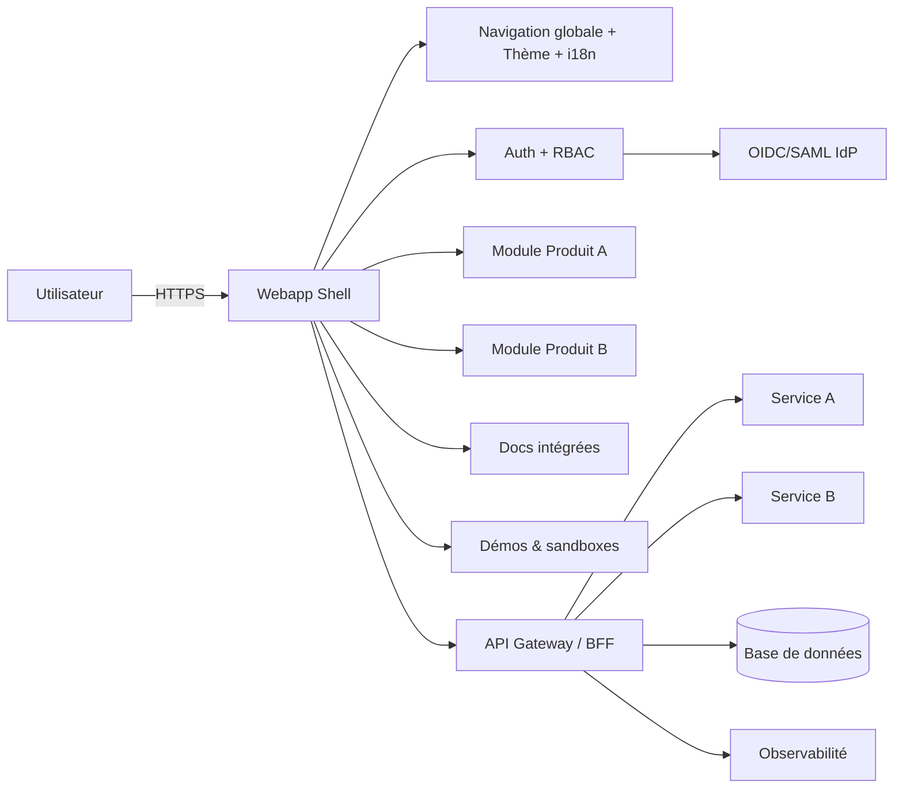

so for my non profit org i offer free open source self hostable software solution and i need a website. so i have multiple products and will have even more ! I need you to tell me all i can do for best ux and ui and feature rich webapp. i do not want a static website simple. i want a full application but for branding and all my apps. maybe literal demo inside pages or integrations and so on. research all cool stuff i can do for application not static page. like for example posthog did great! they didn't do a static website but a full OS experience in browser lol. thats original. research and write report
---
# Concevoir une application web multi-produit, open source et auto‑hébergeable pour une organisation à but non lucratif

## Synthèse exécutive

Une application web « portail + console » multi-produit, open source et auto‑hébergeable (non un site statique) doit concilier trois objectifs qui se tirent souvent la couverture : extensibilité (ajouter des produits sans réécrire la navigation), expérience produit « OS‑like » (panneaux, états persistants, démos interactives, intégrations) et simplicité radicale du self‑hosting (documentation, packaging, mises à jour). Les organisations qui réussissent cet équilibre (PostHog, Supabase, GitLab, Nextcloud, Sentry) y arrivent en industrialisant la cohérence UI, la modularité du code et la distribution (Docker/Compose, parfois Kubernetes), tout en maintenant une exigence forte sur l’accessibilité et la conformité. citeturn19view0turn6search13turn6search0turn6search2turn6search3

Recommandation centrale : démarrer avec un **modular monolith** (front + back unifiés, modules de produits « plug-in ») dans un **monorepo** avec **design system** et **design tokens**, et préparer une migration progressive vers des **microfrontends** uniquement si (et quand) l’organisation a des équipes/rythmes de livraison réellement indépendants par produit. Cela limite les coûts de coordination et réduit la complexité de déploiement pour les auto‑hébergeurs, tout en gardant une trajectoire de scalabilité (Module Federation / single-spa) prête. citeturn1search11turn1search3turn1search20

Pour les démos et “sandboxes”, il faut **stratifier** : (1) démos 100% navigateur (exemples interactifs type Sandpack) pour l’immédiateté, (2) runtimes navigateur (WebContainers) pour des expériences « quasi full‑stack » sans serveur, (3) environnements éphémères isolés côté serveur (conteneurs jetables) dès qu’on exécute du code non fiable ou qu’on a besoin de bases de données réelles. citeturn8search4turn8search25turn8search0

Enfin, l’accessibilité (WCAG/RGAA), la sécurité applicative (OWASP Top 10 + ASVS), la sécurité « supply chain » (Scorecard, Sigstore, SLSA, SBOM) et la conformité RGPD/ePrivacy (CNIL/EDPB, AIPD) ne doivent pas être une couche ajoutée après coup : elles structurent les composants UI, les flux d’onboarding, la collecte analytique et la pipeline CI/CD. citeturn0search2turn2search0turn2search18turn7search2turn7search3turn11search0turn11search1turn11search6turn0search7turn10search2turn10search7

## Références concurrentielles et études de cas

PostHog est un exemple particulièrement proche de votre cible sur trois axes : **webapp riche** (navigation latérale, dashboards, templates), **intégrations** et **self‑hosting documenté**. Leur documentation indique explicitement que l’outil est open source, propose un déploiement **Docker Compose** (MIT) et décrit les compromis (pas de garanties/support payant pour le self‑host, différentiel cloud vs auto‑hébergé). citeturn19view0turn19view1 Leur notion de « Product OS » formalise l’idée de fondation commune (données + primitives) sur laquelle s’alignent les “apps” (analytics, web analytics, session replay, feature flags, surveys, etc.). citeturn14search22turn14search0 Pour l’aspect « expérience OS », la fonctionnalité “toolbar” (overlay) montre une approche d’interaction “in‑context” sur le produit de l’utilisateur (inspection, heatmaps, override de flags). citeturn14search2 Les pages produits et docs contiennent des visuels et exemples concrets (dashboards, web analytics, etc.), utiles comme inspiration de composition d’écrans. citeturn14search15turn14search19turn14search23

Figma constitue surtout une référence UX : application web au ressenti « desktop », extensible via un écosystème (plugins) et complétée par des APIs. Leur documentation développeur met en avant l’existence d’une **Plugin API** pour étendre l’outil et d’une **REST API**. citeturn0search1turn0search5turn0search9 La leçon pour votre portail : l’expérience “OS‑like” n’est pas une question de framework mais de **modèle d’interface** (états persistants, espaces de travail, raccourcis, palettes de commande, panneaux, gestion fine du focus, performances).

Au-delà de ces deux références, plusieurs projets apportent des patterns “multi‑produit” directement transposables :

- **entity["company","GitLab","devops platform company"]** : la présence d’un design system public (Pajamas) illustre l’investissement nécessaire pour scaler la cohérence UI sur un produit vaste et en évolution constante. citeturn6search0turn6search16
- **entity["company","Supabase","open source backend platform"]** : documentation “self‑hosting” explicitant quand l’auto‑hébergement fait sens, et déploiement Docker comme voie simplifiée (avec différentiel clair entre self‑host, CLI dev locale et offre managée). citeturn6search1turn6search13turn6search25 Supabase montre aussi un vrai “console UX” (Supabase Studio) réutilisable comme référence d’IA (information architecture) de console multi‑services. citeturn6search9
- **entity["company","Nextcloud","self-hosted collaboration platform company"]** : stratégie « suite modulaire » via un app store, plus une navigation structurée côté apps (documentation développeur sur les entrées de navigation, patterns de sidebar). citeturn6search2turn6search10turn6search14turn6search18
- **entity["company","Sentry","application monitoring company"]** : offre et maintient une version self‑hosted “minimal setup”, tout en cadrant les attentes (communauté, absence de garanties). citeturn6search3turn6search35 C’est une référence utile pour calibrer un **niveau réaliste de support** envers les auto‑hébergeurs.

image_group{"layout":"carousel","aspect_ratio":"16:9","query":["PostHog dashboard screenshot","Supabase Studio dashboard screenshot","GitLab UI screenshots issues merge requests","Nextcloud web interface screenshot left sidebar apps","Sentry UI screenshot issue details"],"num_per_query":1}

En synthèse des cas, on retrouve un invariant : la scalabilité “multi‑produit” se construit avec (a) une **fondation de navigation et d’identité** stable, (b) un **design system** documenté/outilé, (c) une **distribution self‑host** frugale (Docker Compose au minimum), et (d) une posture explicite sur le support communautaire. citeturn19view0turn6search0turn6search13turn6search18turn6search3

## UX/UI et design system pour une navigation multi-produit « OS‑like »

Une expérience « OS‑like » dans le navigateur implique de traiter votre app comme un **environnement de travail** : navigation globale + navigation locale, états persistants, densité d’information maîtrisée, et opérations fréquentes accélérées (raccourcis, recherche, actions contextuelles). Les guides WAI-ARIA (APG) sont une boussole incontournable pour construire ces patterns complexes (menus, tabs, treeviews, dialogs, combobox, etc.) de façon accessible, en complément des exigences RGAA/WCAG. citeturn13search0turn13search3turn0search2turn2search0

### Patterns IA (information architecture) recommandés

**Navigation globale multi‑produit (niveau suite)**  
Un schéma qui se répète chez les suites : une “barre produit” stable (logo, switcher de produit, recherche globale, notifications, profil) + une “sidebar” contextualisée au produit. Nextcloud documente directement les conventions de sidebar et d’homogénéité entre apps, ce qui illustre l’importance d’une navigation cohérente à travers des modules. citeturn6search14turn6search10

**Switching sans rupture**  
Objectif : passer d’un produit A à un produit B en conservant contexte de compte, permissions, préférences (langue, thème), et idéalement une partie de l’état (ex. dernière org/projet). C’est un prérequis pour que l’ajout de produits soit perçu comme une expansion naturelle, pas comme des sites séparés.

**Panneaux latéraux et “command palette”**  
Pour les webapps denses (analytics, consoles), les panneaux latéraux permettent d’éviter la navigation en profondeur (drill‑down) : détails d’un objet, configuration rapide, logs, etc. La “toolbar” de PostHog illustre l’idée d’outils contextuels superposés, séparés des écrans principaux. citeturn14search2

### Design system : options pragmatiques et recommandations

Pour atteindre « brandable + excellente UX/UI » tout en restant open source, deux stratégies dominent.

**Stratégie A : bibliothèque de composants “prête à l’emploi” (accélération)**  
Exemple typique : Material UI, présenté comme librairie open source de composants React implémentant Material Design, utilisable “out of the box”. citeturn9search1turn9search17 Avantages : vitesse, couverture de composants, documentation, accessibilité souvent correcte par défaut. Limites : risque de “look générique”, personnalisation parfois coûteuse (tokens, variantes, densité, patterns “OS‑like”).

**Stratégie B : primitives accessibles + design tokens (contrôle maximal)**  
Radix Primitives se positionne comme une librairie open source de composants bas niveau, focalisée accessibilité et customisation, utilisable comme couche de base du design system. citeturn9search4turn9search0 Associée à une approche utility-first type Tailwind (classes utilitaires combinées directement dans le markup), on obtient une capacité de branding fine et un contrôle sur la densité/ergonomie. citeturn9search22turn9search10 Le verrou ici, c’est la gouvernance du design system : tokens, variantes, docs et discipline d’usage.

**Design tokens et cohérence multi‑produit**  
Un système de tokens (couleurs, typographies, spacing, radius, ombres, motion) permet de centraliser le branding tout en autorisant des “thèmes” par produit. Style Dictionary est explicitement conçu pour exporter des design tokens vers différentes plateformes (CSS, JS, etc.). citeturn9search3turn9search15 Sur une suite multi‑produit, cela devient le socle de la “brandability” : vous pouvez garantir un look cohérent, y compris quand de nouveaux produits arrivent.

**Référence organisationnelle**  
Le design system public de GitLab (Pajamas) montre l’intérêt de documenter non seulement des composants mais aussi des “foundations”, patterns, contenu, et d’outiller un cycle de contribution (design + code + doc). citeturn6search0turn6search16

### Tableau de comparaison (UI stack + design system)

| Option UI | Ce que vous obtenez rapidement | Points de vigilance | Quand c’est le meilleur choix |
|---|---|---|---|
| Material UI (composants complets) citeturn9search17 | Composants nombreux, démarrage rapide, theming | “Look Material” à neutraliser, dette de personnalisation | Équipe réduite, MVP rapide, besoin de composants data-grid/form prêts |
| Primitives accessibles (Radix) + tokens (Style Dictionary) + utilitaires (Tailwind) citeturn9search4turn9search15turn9search22 | Branding fin, composants à votre ergonomie, densité “console” | Maintenance DS, besoin d’une gouvernance stricte | Ambition UX élevée, suite long terme, identité visuelle forte |
| Design system inspiré d’un référentiel public (Pajamas) citeturn6search0 | Cadre de patterns + gouvernance déjà “prouvée” | Adapter ≠ copier ; effort de documentation | Organisation multi‑équipes, contributions externes à long terme |

## Architecture modulaire et patterns de déploiement

Votre contrainte structurante est rare : **une webapp riche** ET **auto‑hébergeable** par des tiers. Cela oriente fortement l’architecture : chaque couche ajoutée (microservices, microfrontends, orchestrateurs) augmente le coût cognitif des auto‑hébergeurs, donc doit être justifiée par un gain net (scalabilité organisationnelle, sécurité isolation, performance, etc.).

### Trois options d’architecture front “multi‑produit”

**Option recommandée (départ) : modular monolith dans un monorepo**  
- Un “shell” (layout, routing, auth, i18n, thème) et des modules “produit” livrés dans le même build.  
- Partage simple du design system, du client API, des permissions, et de l’instrumentation.  
- Idéal pour MVP → v1 lorsque l’équipe est petite ou moyenne.

Ce choix s’aligne bien avec une organisation monorepo outillée (Nx) et des patterns de librairies partagées (UI, tokens, SDK interne). Nx documente explicitement l’intégration avec Storybook (component docs) et la structuration de libs dans un monorepo. citeturn1search20turn1search6

**Option “scale équipes” : microfrontends (Module Federation ou single-spa)**  
Webpack décrit Module Federation comme un mécanisme permettant de partager du code entre builds, couramment mobilisé dans des architectures microfrontends. citeturn1search11 single-spa se présente comme un framework de microfrontends permettant de composer plusieurs frontends sur une même page. citeturn1search3  
À réserver si vous avez (a) des équipes produit réellement autonomes, (b) des cycles de release découplés, (c) une gouvernance de versions et de design system robuste.

**Option “suite de produits séparés” : portail + liens/embeds**  
Un portail central (catalogue, docs, onboarding) renvoie vers des apps distinctes. Cette option réduit la complexité du portail mais crée souvent une expérience utilisateur fragmentée (navigation, permissions, préférences).

### Déploiement : self‑host « simple par défaut », extensible vers K8s

Pour l’auto‑hébergement, le “gold standard” de simplicité reste Docker Compose, présenté comme outil pour définir et exécuter des applications multi‑conteneurs. citeturn15search13turn15search3 PostHog et Supabase montrent concrètement l’approche “Docker d’abord” pour self‑host, avec un guidage et des avertissements sur le niveau d’effort/support. citeturn19view0turn6search13turn6search1

Pour les déploiements plus industriels : Helm (charts) fournit un format de packaging de ressources Kubernetes. citeturn15search2turn15search6 Flux et Argo CD sont des outils GitOps : ils synchronisent l’état désiré (défini dans Git) avec l’état réel du cluster. citeturn15search0turn15search1

### Tableau comparatif (distribution / hosting)

| Pattern | Pour qui | Avantages | Coûts / risques |
|---|---|---|---|
| Docker Compose (référence auto‑hébergeur) citeturn15search13 | Communauté, petites équipes ops | Installation rapide, reproductible, doc simple | Scalabilité limitée, upgrades à cadrer |
| Helm + Kubernetes citeturn15search2 | Entreprises, volumes, HA | Scalabilité, HA, intégration infra | Complexité, forte exigence ops |
| GitOps (Flux / Argo CD) citeturn15search0turn15search1 | Équipes platform | Auditabilité, drift control | Apprentissage, outillage additionnel |
| Offre managée (optionnelle) | Adopteurs “SaaS” | Expérience utilisateur “best” | Exigences légales/contractuelles |

### Diagramme mermaid (architecture cible “shell + modules”)



## Expérience développeur, documentation et démos interactives

Votre “produit” n’est pas seulement une suite logicielle : c’est aussi un **parcours développeur**. La qualité de la documentation self‑host et des intégrations est un facteur d’adoption (et de réduction du support).

### Documentation : versioning, i18n, intégration dans la webapp

Docusaurus offre des fonctionnalités structurantes pour un portail docs : **versioning** et **internationalisation** (i18n). citeturn1search2turn1search7 Pour une suite multi‑produit, cela permet (a) d’aligner docs et versions de produits, (b) de gérer des docs par produit, mais sous une expérience homogène (recherche, navigation, branding).

Côté localisation de l’app elle-même, i18next se présente comme framework d’internationalisation JavaScript, et FormatJS/React Intl fournit une stack robuste autour du format ICU. citeturn12search2turn12search6turn12search32

### API explorer et “self‑serve” intégrations

- OpenAPI définit une spécification standard, agnostique langage, pour décrire des APIs HTTP. citeturn5search4turn5search13  
- Swagger UI génère une documentation interactive à partir d’une spec OpenAPI. citeturn5search1turn5search11  
- GraphiQL se présente comme IDE GraphQL de référence (projet officiel GraphQL Foundation) utile si vous exposez un schéma GraphQL (ou un gateway). citeturn5search2turn5search6

La recommandation pragmatique pour un portail multi‑produit : **OpenAPI par défaut** pour toutes les APIs publiques + explorateur intégré (Swagger UI ou équivalent), et GraphiQL uniquement si GraphQL est déjà un choix stratégique.

### Démos / sandboxes : trois niveaux d’ambition

**Niveau 1 — Démo interactive “front-only” (MVP)**  
Sandpack est présenté comme toolkit de composants pour créer des expériences d’édition/exécution de code dans le navigateur, “powered by CodeSandbox”. citeturn8search4turn8search1 C’est idéal pour : snippets interactifs, tutos, composants UI, SDK samples.

**Niveau 2 — Runtime navigateur (expérience “fullstack-lite”)**  
WebContainers (StackBlitz) visent à exécuter des applications Node.js et des commandes “dans l’onglet du navigateur”, ce qui permet des démos plus réalistes sans provisionner de serveurs de sandbox. citeturn8search25turn8search0

**Niveau 3 — Environnements isolés (production-grade demo)**  
Dès que vous exécutez du code tiers, vous devez isoler : le modèle standard est un conteneur jetable par session, avec quotas, timeouts, nettoyage. Ce niveau est coûteux mais permet des démos très proches du réel (DB, auth, pipelines).

Pour construire des éditeurs riches, Monaco Editor est documenté comme l’éditeur “fully featured” issu de VS Code. citeturn8search2turn8search5 Pour des expériences “IDE dans le web”, Eclipse Theia se positionne comme plateforme open source pour bâtir des IDE cloud/desktop sur technologies web. citeturn8search3turn8search6turn8search12

image_group{"layout":"carousel","aspect_ratio":"16:9","query":["Sandpack live code editor screenshot","StackBlitz WebContainers demo screenshot","Monaco Editor playground screenshot","Eclipse Theia IDE in browser screenshot"],"num_per_query":1}

### CI/CD pour docs, démos et qualité UI

- Lighthouse est un outil open source d’audit automatisé (performance, accessibilité, SEO, etc.) et peut être intégré via Lighthouse CI pour prévenir les régressions. citeturn7search1  
- playbook E2E : Playwright se présente comme framework de tests end‑to‑end fiable multi‑navigateurs, adapté aux webapps modernes. citeturn12search1turn12search14  
- accessibilité automatisée : axe-core est un moteur de tests d’accessibilité automatisés, intégrable dans des environnements de test existants. citeturn12search0turn12search4

## Checklist accessibilité, sécurité et confidentialité

### Accessibilité (WCAG / RGAA / EN 301 549)

- WCAG 2.2 est une recommandation W3C (référence internationale). citeturn0search2turn0search14  
- Le RGAA (France) fournit une méthode opérationnelle et insiste sur un **environnement de test** (combinaisons technologies d’assistance / OS / navigateurs) pour valider la compatibilité ARIA/WCAG. citeturn2search0turn13search3  
- L’ARIA Authoring Practices Guide (APG) décrit des patterns et exemples pour appliquer correctement la sémantique ARIA aux widgets. citeturn13search0turn13search8  
- EN 301 549 est un standard européen harmonisé supportant la directive accessibilité web du secteur public et évoluant pour couvrir d’autres exigences (y compris au regard de l’EAA). citeturn13search1turn13search2

**Contrôles UI prioritaires (orientés webapp “console”)** : navigation clavier et focus visible, composants composites (tabs, menus, combobox), contraste, messages d’erreur, annonces ARIA non intrusives, prise en charge du zoom/texte, densité (espacements) modulable.

### Sécurité applicative (OWASP + ASVS + bonnes pratiques session/auth)

- OWASP Top 10 est un document de sensibilisation sur les risques majeurs ; le site OWASP indique une édition 2025, et l’édition 2021 reste très utilisée. citeturn2search18turn2search8  
- OWASP ASVS fournit une base testable de contrôles de sécurité techniques pour applications web. citeturn7search2turn7search6  
- Le cheat sheet OWASP sur la gestion de session souligne que la compromission du token de session mène à l’usurpation et détaille des propriétés attendues (unicité, imprédictibilité, etc.). citeturn16search3

**Pour une suite multi‑produit** : privilégier un modèle SSO standard. entity["organization","OpenID Foundation","identity standards body"] publie la spec OpenID Connect, décrite comme protocole d’authentification construit sur OAuth 2.0. citeturn16search2turn16search14 Pour une implémentation self‑hostable, entity["organization","Keycloak","open source iam project"] se présente comme compatible OIDC/OAuth2/SAML et propose des services d’autorisation fine. citeturn16search0turn16search8

### Confidentialité, RGPD et ePrivacy (cookies/traceurs, AIPD)

- La CNIL publie des guides opérationnels, dont une édition 2024 du guide de sécurité des données personnelles (mesures organisationnelles et techniques). entity["organization","CNIL","french data protection authority"] citeturn4search2turn4search6  
- La CNIL encadre l’analyse d’impact (AIPD) comme outil pour construire un traitement conforme et traiter les risques élevés. citeturn10search7turn10search3  
- L’EDPB publie des guidelines sur la portée technique de l’article 5(3) de la directive ePrivacy (règle “cookies et traceurs”), notamment pour clarifier l’application à des outils de tracking émergents. entity["organization","EDPB","european data protection board"] citeturn10search2  
- Pour une analytics “privacy-preserving”, il est essentiel de se référer aux conditions d’exemption / consentement. La CNIL détaille les règles “mesure d’audience” et cookies/traceurs. citeturn0search7

### Sécurité supply chain et qualité open source

Une organisation open source gagne en crédibilité en outillant sa supply chain :

- OpenSSF Scorecard réalise des checks automatisés pour évaluer des risques de sécurité sur les projets open source. entity["organization","OpenSSF","open source security foundation"] citeturn7search3turn7search7  
- Sigstore vise la signature/vérification d’artefacts et l’audit via log de transparence. citeturn11search0turn11search14  
- SLSA fournit un cadre “Supply-chain Levels for Software Artifacts” avec exigences graduelles. citeturn11search1  
- CycloneDX est un standard BOM/SBOM (ECMA-424) promu par OWASP pour la transparence supply chain. citeturn11search12turn11search9  
- Côté gouvernance, les “community health files” (CODE_OF_CONDUCT, CONTRIBUTING, SECURITY, etc.) peuvent être standardisés via GitHub. entity["company","GitHub","code hosting platform"] citeturn11search3turn11search10

## Backlog priorisé, feuille de route et métriques

### Liste de fonctionnalités priorisée (MVP → v2)

Le découpage ci-dessous part d’une hypothèse raisonnable : vous voulez un **portail multi‑produit** qui peut croître, avec un **socle commun** (branding, navigation, identité, docs, démos), puis des capacités console plus avancées.

| Domaine | MVP (objectif : adoption) | v1 (objectif : activation & rétention) | v2 (objectif : écosystème & scalabilité) | Rationale |
|---|---|---|---|---|
| Identité & comptes | Auth simple + organisations/projets + RBAC de base | SSO OIDC, règles d’accès plus fines, audit logs “essentiels” | Multi‑tenant avancé, policies externalisées | SSO standardise l’accès multi‑produit et réduit la friction. citeturn16search2turn16search0turn16search3 |
| Navigation multi‑produit | Product switcher, IA stable, recherche docs | Recherche globale (docs + objets), “recent” et “pinned” | Personnalisation par rôle, macros/command palette | Réduit le coût de découverte, nécessaire à une suite. citeturn6search14turn13search0 |
| Catalogue & pages produit | Fiches produit, cas d’usage, comparatif self‑host/managed | Templates “getting started” par stack | Marketplace d’extensions | Scalabilité “ajout produit” sans refonte IA. |
| Démos | Sandpack snippets + exemples interactifs | WebContainers pour démos “fullstack-lite” | Sandboxes isolées (conteneurs jetables) | Stratégie en couches selon coût et risque. citeturn8search4turn8search0turn8search25 |
| Documentation self‑host | Quickstart Docker Compose + upgrade guide | Guides Helm + observabilité + hardening | GitOps (Flux/Argo) + matrice de support | Les auto‑hébergeurs veulent un chemin minimal et fiable. citeturn15search13turn19view0turn15search2turn15search0turn15search1 |
| Intégrations & API | OpenAPI + Swagger UI, clés API, webhooks | SDKs, exemples “recipes”, intégrations issues | Connectors/plug-ins versionnés | L’écosystème se développe via APIs + docs interactives. citeturn5search4turn5search11turn5search1 |
| Analytics (privacy) | Mesures produit minimales + opt‑out | Matomo/Plausible self‑host, dashboards internes | Segmentation avancée sans PII | La CNIL/EDPB impose de cadrer cookies/traceurs et minimisation. citeturn0search7turn10search2turn4search16turn4search13 |

### Roadmap indicative (jalons + effort)

Les estimations ci-dessous sont volontairement **en fourchettes** (la variabilité est forte : nombre de produits initiaux, profondeur des démos, exigence SSO, niveau d’auto‑hébergement). Elles supposent une équipe “core” (PM/UX + 2–4 devs full‑stack + 0.5–1 DevOps + 0.25–0.5 référent a11y/compliance).

| Milestone | Périmètre | Effort typique |
|---|---|---|
| Socle portail | IA navigation, theming/tokens, i18n, pages produit, routing, base API | 4–8 semaines‑personnes |
| MVP self‑host | Docker Compose, doc quickstart, configuration, upgrades, hardening minimal | 3–6 semaines‑personnes citeturn15search13turn19view0 |
| MVP démos | Sandpack + premières démos par produit | 2–5 semaines‑personnes citeturn8search4 |
| v1 console | RBAC, audit de base, intégrations (webhooks), API Explorer OpenAPI | 6–12 semaines‑personnes citeturn5search4turn5search11turn7search2 |
| Qualité & conformité | RGAA/WCAG + tests (axe-core, Lighthouse, Playwright) + observabilité | 4–10 semaines‑personnes citeturn13search0turn13search3turn12search0turn7search1turn12search14turn4search6turn7search0 |
| v2 scalabilité | Microfrontends (si justifié), marketplace/extensions, sandboxes isolées | 8–20+ semaines‑personnes citeturn1search11turn1search3turn8search3 |

### Métriques recommandées (produit, qualité, conformité)

**Activation & adoption** : taux “time‑to‑first‑value” (ex. création d’un projet + exécution d’une démo + première intégration), complétion onboarding, taux de retour à J+7/J+30, usage par produit (adoption cross‑product).  
**Docs/DX** : taux de succès recherche docs, pages “getting started” les plus consultées, résolution sans support (ratio vues docs / tickets). Docusaurus facilitant versioning/i18n, un bon suivi par version de doc est clé. citeturn1search7turn1search2  
**Performance UX** : suivi Core Web Vitals (LCP, CLS, INP) et budgets performance, avec audits Lighthouse automatisés. citeturn7search0turn7search1turn7search24  
**Accessibilité** : score Lighthouse accessibilité (à manier avec prudence) + couverture axe-core + audits manuels RGAA/APG sur composants critiques (tabs, dialogs, combobox) et environnements de test. citeturn7search5turn12search0turn13search3turn13search0  
**Sécurité** : couverture ASVS sur périmètre MVP/v1, suivi OWASP Top 10, délais de patch dépendances, score OpenSSF Scorecard, présence SBOM + signature (Sigstore) sur releases. citeturn7search2turn2search18turn7search3turn11search0turn11search12  
**Privacy** : minimisation des données collectées, conformité cookie/traceurs selon CNIL/EDPB, existence et mise à jour d’AIPD quand nécessaire. citeturn0search7turn10search2turn10search7turn10search3

### Recommandations d’outils open source (sélection orientée “suite multi‑produit”)

- Frontend full‑stack : Next.js (React) ou Remix ou SvelteKit (selon expertise/contraintes). citeturn17search0turn17search1turn17search2  
- Backend API : FastAPI (Python), Django (Python), NestJS (Node/TS), Spring Boot (Java) selon compétences/éco‑système et besoins. citeturn17search3turn18search0turn18search1turn18search7  
- Auth/SSO : Keycloak (OIDC/OAuth2/SAML) + OIDC (spec OpenID). citeturn16search0turn16search2  
- Docs : Docusaurus (versioning + i18n). citeturn1search7turn1search2  
- API explorer : OpenAPI + Swagger UI. citeturn5search4turn5search11turn5search1  
- Démos : Sandpack (niveau 1), WebContainers (niveau 2). citeturn8search4turn8search25turn8search0  
- A11y/qualité : axe-core + Playwright + Lighthouse CI. citeturn12search0turn12search14turn7search1  
- Analytics “privacy‑first” : Matomo (auto‑hébergeable) ou Plausible (Community Edition self‑host). entity["company","Matomo","web analytics company"] citeturn4search16turn4search4turn4search13turn4search28  
- Supply chain : OpenSSF Scorecard + Sigstore + SLSA + CycloneDX SBOM. citeturn7search3turn11search0turn11search1turn11search12
---
Now tell me about all the email integration I can have ? For example what do you think in the landing page a waitlist that is for being notified anytime a new ISLAMU software comes out ? With information text telling that and that if hey only want yo get notified of a specific project they should go to that products page in the website where there will be the wait-list for the product release ? Suggest many more ideas email related and non email related. Answer in english
---
Yes — the landing page **should have a global waitlist**, but not as a generic “newsletter.” For ISLAMU, it should feel like a **software release radar**.

Your idea is good:

> “Join the ISLAMU release list to be notified when new free, open-source, self-hostable software becomes available. For updates about one specific product, go to that product page and join its dedicated release list.”

That is the correct hierarchy.

But you can go much further.

# 1. The best email strategy for ISLAMU

You should have **three levels of subscription**, not one.

## Level 1 — Global ISLAMU release radar

This is for people who want to know whenever ISLAMU launches any new software.

Example copy:

> Get notified when ISLAMU releases new free, open-source, self-hostable tools for communities, nonprofits, education, events, asset management, and digital infrastructure.

This should be on the homepage, footer, product catalog, and “Coming soon” pages.

## Level 2 — Product-specific waitlists

Each product should have its own waitlist.

Examples:

| Product                      | Email list purpose                                            |
| ---------------------------- | ------------------------------------------------------------- |
| ISLAMU Event                 | Event platform releases, demo access, self-hosting guides     |
| ISLAMU Asset                 | Digital asset management launch, funding updates, beta access |
| Future ISLAMU CRM            | Early access, use-case validation                             |
| Future ISLAMU Docs/Knowledge | Community testing and documentation updates                   |

This is better than one list because a developer interested in ISLAMU Event may not care about ISLAMU Asset, and a nonprofit manager may care about all releases but not technical changelogs.

## Level 3 — Preference center

After subscribing, users should be able to choose:

| Preference      | Options                                                                        |
| --------------- | ------------------------------------------------------------------------------ |
| Products        | Event, Asset, CRM, Docs, All future tools                                      |
| Role            | Nonprofit leader, developer, self-hoster, contributor, donor, partner          |
| Email type      | Major releases, beta invitations, security updates, tutorials, funding updates |
| Frequency       | Immediate, weekly digest, monthly digest                                       |
| Language        | English, French, Dutch, Arabic later if needed                                 |
| Technical depth | Non-technical, admin, developer, DevOps                                        |

This makes the website feel professional and application-like, not like a simple marketing page.

# 2. Email features I would build

## 2.1 Global waitlist with smart routing

When someone joins from the homepage, ask a simple question:

> What are you interested in?

Options:

| Option                           | Tag                        |
| -------------------------------- | -------------------------- |
| All ISLAMU software              | `interest:all`             |
| Event management                 | `product:event`            |
| Asset/document management        | `product:asset`            |
| Self-hosting                     | `persona:self-hoster`      |
| Contributing code                | `persona:contributor`      |
| Funding or partnership           | `persona:funder`           |
| Nonprofit digital transformation | `persona:nonprofit-leader` |

Do not ask for too much at first. Email + one interest question is enough. Then the welcome email can invite them to complete preferences.

## 2.2 Product launch waitlists

Each product page should have a dedicated module:

> Follow ISLAMU Event
> Get notified about releases, self-hosting guides, live demos, and beta access.

For unreleased products:

> Join the early access list
> We’ll invite selected organizations to test the product before public release.

For released products:

> Get release updates
> Security advisories, migration guides, new modules, and community calls.

## 2.3 Beta access campaigns

For each product, create beta cohorts:

| Cohort                  | Purpose                                    |
| ----------------------- | ------------------------------------------ |
| `beta:event-nonprofits` | Nonprofit event organizers                 |
| `beta:event-devops`     | Self-hosting testers                       |
| `beta:asset-libraries`  | Organizations managing documents/media     |
| `beta:contributors`     | Developers willing to test unstable builds |

Then send targeted emails like:

> We’re opening 20 early-access slots for ISLAMU Asset. Priority goes to nonprofits that manage media, files, documents, or public archives.

This is powerful for grants because it shows structured community validation.

## 2.4 Release emails

Every product should support these email categories:

| Email type          | Example                                      |
| ------------------- | -------------------------------------------- |
| Launch announcement | “ISLAMU Event v1 is now available”           |
| Security advisory   | “Important update for self-hosted instances” |
| Migration guide     | “How to upgrade from v0.8 to v0.9”           |
| New module          | “Registration roles are now event-scoped”    |
| Demo invitation     | “Try the live event management demo”         |
| Community update    | “What we shipped this month”                 |
| Funding update      | “What grant funding helped us build”         |

This makes email part of the product experience, not just marketing.

## 2.5 “Follow this feature” email

This would be very original.

On roadmap pages, product pages, or docs, users can click:

> Follow this feature

Examples:

| Feature                            | Email behavior                          |
| ---------------------------------- | --------------------------------------- |
| “3D venue maps”                    | Notify when prototype/demo is available |
| “Self-host Docker installer”       | Notify when guide is ready              |
| “Asset approval workflows”         | Notify when beta opens                  |
| “Keycloak integration”             | Notify when docs are updated            |
| “Event-specific operational roles” | Notify when released                    |

This is excellent UX because users do not only follow products; they follow **problems they care about**.

## 2.6 “Notify me when this product is self-hostable”

For each product, have a deployment status:

| Status               | CTA                                      |
| -------------------- | ---------------------------------------- |
| Concept              | “Follow progress”                        |
| Prototype            | “Join early testers”                     |
| Cloud demo available | “Try demo”                               |
| Docker Compose ready | “Notify me when install guide is stable” |
| Production-ready     | “Get release/security updates”           |

This fits your nonprofit/open-source/self-hostable identity perfectly.

## 2.7 Demo follow-up emails

If the website has live demos, every demo should have a follow-up flow.

Example:

User tries ISLAMU Event demo → system sends:

1. “Here’s what you tested”
2. “Deploy it locally with Docker”
3. “Compare ISLAMU Event with Eventbrite / Pretix / Odoo”
4. “Join the product waitlist or community call”

This turns the demo into an onboarding journey.

## 2.8 Self-hosting email sequences

For self-hostable software, email should help people actually deploy.

Example sequence:

| Email | Subject                                                |
| ----- | ------------------------------------------------------ |
| 1     | “Your ISLAMU Event self-hosting checklist”             |
| 2     | “Docker Compose setup explained”                       |
| 3     | “Keycloak, PostgreSQL, Cerbos: what each service does” |
| 4     | “Production hardening checklist”                       |
| 5     | “Common deployment mistakes”                           |
| 6     | “Join the self-hosting support community”              |

This is much more useful than a normal newsletter.

## 2.9 Security and maintenance list

You need a separate **security announcements** list.

This should not be mixed with marketing.

Examples:

| List               | Purpose                                              |
| ------------------ | ---------------------------------------------------- |
| `security:all`     | Critical security advisories                         |
| `security:event`   | ISLAMU Event security updates                        |
| `ops:self-hosters` | Upgrade notes, breaking changes, maintenance windows |

For enterprise-grade self-hostable software, this is important for trust.

## 2.10 Contributor onboarding emails

For developers:

| Email               | Content                                          |
| ------------------- | ------------------------------------------------ |
| Welcome contributor | Mission, repos, contribution rules               |
| Good first issues   | Links by product                                 |
| Architecture intro  | Clean Architecture, CQRS, Blazor, Keycloak, etc. |
| Local dev setup     | Docker, .NET, Postgres, Keycloak                 |
| Community rhythm    | Calls, discussions, roadmap                      |

This helps convert visitors into contributors.

## 2.11 Funding and impact newsletter

Because ISLAMU is nonprofit, you should have a separate list for donors, grant reviewers, and partners.

Example:

> ISLAMU Impact Updates
> See what free, open-source software we are building for nonprofits and communities.

This should include:

| Section                     | Why it matters     |
| --------------------------- | ------------------ |
| New releases                | Shows execution    |
| Organizations helped        | Shows impact       |
| Volunteer/contributor stats | Shows community    |
| Roadmap                     | Shows direction    |
| Funding needs               | Shows transparency |
| Public demos                | Shows credibility  |

This is extremely useful for grants.

# 3. Email system architecture I recommend

You should separate **email product logic** from **email delivery**.

## Core idea

Your ISLAMU website/app should own:

| Owned by ISLAMU app   | Example                                                    |
| --------------------- | ---------------------------------------------------------- |
| User preferences      | Product interests, language, frequency                     |
| Consent records       | When/where/how user subscribed                             |
| Product subscriptions | Event, Asset, CRM, etc.                                    |
| Email events          | `joined_waitlist`, `downloaded_docker_guide`, `tried_demo` |
| Suppression state     | Unsubscribed, bounced, complained                          |
| Audit trail           | Important for GDPR and trust                               |

Then use an email tool/provider for actual sending.

## Tool options

For open-source/self-hosted alignment, **listmonk** is a very strong fit. It is a self-hosted newsletter and mailing list manager, runs as a standalone binary with PostgreSQL, supports APIs, segmentation, templates, transactional messages, OIDC SSO, roles, permissions, and messenger webhooks. ([Listmonk][1])

For more advanced marketing automation, **Mautic** is the bigger platform. It is open-source marketing automation with campaign building, email/page builders, APIs, webhooks, themes, plugins, and community documentation. ([Mautic][2])

For delivery, you can use a transactional provider instead of running your own mail infrastructure. Amazon SES supports sending through console, SMTP, and API, while Brevo supports transactional emails through API, SMTP, and webhooks; Resend is also developer-focused with a simple email API. ([Amazon Web Services, Inc.][3])

My recommendation:

| Stage               | Stack                                                           |
| ------------------- | --------------------------------------------------------------- |
| MVP                 | Your app + listmonk + SES/Brevo/Resend                          |
| More automation     | Add Mautic or build lightweight automation internally           |
| Enterprise maturity | Dedicated preference center + event pipeline + email audit logs |
| Development         | MailHog/Mailpit-style local email catching                      |
| Email templates     | MJML for responsive email templates                             |

MJML is useful because email HTML is painful; it provides a responsive email markup system and generates compatible HTML for email clients. ([mjml.io][4])

# 4. Privacy and consent: important for Belgium/EU

Because you are in Europe and this is for a nonprofit, do it cleanly from day one.

CNIL guidance says email prospecting generally requires people to be informed, and for individuals, prior consent is normally required; consent must be free, specific, informed, unambiguous, and based on a positive action like a dedicated unchecked box. Each email should identify the sender and provide a simple unsubscribe method. ([CNIL][5])

So for your forms:

Do this:

```text
[ ] I want to receive updates about ISLAMU software releases, demos, and self-hosting guides.
```

Do **not** pre-check the box.

Do **not** hide email marketing consent inside “I accept terms.”

Do **not** subscribe someone to every product automatically if they only asked about one product.

For every subscriber, store:

| Field                       | Why                                   |
| --------------------------- | ------------------------------------- |
| Email                       | Contact                               |
| Consent text shown          | Proof of what they accepted           |
| Source page                 | Homepage, Event page, Asset page      |
| Timestamp                   | Auditability                          |
| IP/user agent, if justified | Consent proof, but minimize retention |
| Language                    | Correct communication                 |
| Selected products           | Avoid spam                            |
| Unsubscribe token           | Simple opt-out                        |
| Consent version             | If text changes later                 |

# 5. Best UX pattern for the landing page waitlist

Do not make it look like a boring newsletter block.

Make it a **mini product module**.

Example:

```text
Stay close to the ISLAMU software ecosystem

Get notified when we release new free, open-source, self-hostable tools for nonprofits and communities.

[ Email address                 ]

What do you want to follow?
[ ] All ISLAMU releases
[ ] Event management software
[ ] Asset & media management
[ ] Self-hosting guides
[ ] Contributor opportunities
[ ] Funding and impact updates

[ Join release radar ]

Prefer one product only? Visit each product page to follow its dedicated roadmap.
```

After submission:

```text
You’re on the ISLAMU release radar.

Want more control?
Choose your products, language, and email frequency.
```

Then link to preference center.

# 6. Non-email ideas connected to email

Email should not live alone. It should connect with the whole application experience.

## 6.1 Product OS dashboard

Inspired by PostHog’s “Product OS” concept, you could make the website feel like an operating system for ISLAMU software: products, demos, docs, integrations, release status, community, and self-hosting all in one interface. PostHog positions itself around multiple product-building tools such as analytics, session replay, feature flags, experiments, surveys, data warehouse, and integrations inside one platform experience. ([PostHog][6])

For ISLAMU, the equivalent could be:

| App inside ISLAMU Hub | Purpose                              |
| --------------------- | ------------------------------------ |
| Product Catalog       | All ISLAMU software                  |
| Demo Center           | Try live demos                       |
| Install Center        | Generate Docker Compose configs      |
| Docs Center           | Unified docs/search                  |
| Roadmap               | Follow products/features             |
| Community             | Contributors, discussions, calls     |
| Impact Dashboard      | Nonprofit/public benefit metrics     |
| Funding Center        | Grants, donations, sponsorship needs |

## 6.2 Interactive product cards

Each product card should show:

| Field               | Example                                          |
| ------------------- | ------------------------------------------------ |
| Product status      | Concept / Alpha / Beta / Stable                  |
| License             | AGPL / MIT / Apache / etc.                       |
| Self-hosting status | Not ready / Docker ready / production docs ready |
| Demo                | Live demo / video / sandbox                      |
| GitHub              | Repo link                                        |
| Docs                | Documentation                                    |
| Waitlist            | Follow product                                   |
| Security list       | Subscribe to advisories                          |
| Roadmap             | Follow feature                                   |

This is far stronger than a static “Products” page.

## 6.3 Self-hosting readiness wizard

A user answers:

| Question           | Example                               |
| ------------------ | ------------------------------------- |
| What product?      | ISLAMU Event                          |
| Deployment type?   | Docker Compose / Coolify / Kubernetes |
| Identity provider? | Keycloak / external OIDC              |
| Database?          | PostgreSQL                            |
| Reverse proxy?     | Traefik / Caddy / Nginx               |
| Email provider?    | SES / Brevo / SMTP                    |

Then the website generates:

| Output                         |
| ------------------------------ |
| Docker Compose file            |
| Environment variable checklist |
| DNS checklist                  |
| Security checklist             |
| Email setup guide              |
| “Email me this setup” button   |

That last button is a great email capture because it is useful, not spammy.

## 6.4 Demo session emails

Let users start a demo session:

> Try ISLAMU Event with sample data

After the demo:

> Send me my demo summary

Email content:

| Section                  |
| ------------------------ |
| Features explored        |
| Relevant docs            |
| Deployment guide         |
| Product roadmap          |
| Feedback link            |
| Invite to beta/community |

## 6.5 Public roadmap with follow buttons

Every roadmap item can have:

| Action                    |
| ------------------------- |
| Follow feature            |
| Vote                      |
| Comment                   |
| Join beta                 |
| See related GitHub issue  |
| Get notified when shipped |

This gives you product validation and an email graph at the same time.

## 6.6 Open-source contributor portal

Not email-only, but email integrated.

Features:

| Feature                | Email connection              |
| ---------------------- | ----------------------------- |
| Good first issues      | Weekly contributor digest     |
| Contributor onboarding | Email sequence                |
| Docs tasks             | Notify technical writers      |
| Translation tasks      | Notify bilingual volunteers   |
| Security reports       | Private security contact      |
| Maintainer notes       | Monthly project health digest |

## 6.7 Grant/funding dashboard

For funders:

| Feature                            |
| ---------------------------------- |
| Public roadmap                     |
| Impact metrics                     |
| Product maturity matrix            |
| Testimonials                       |
| Deployment map                     |
| Funding needs by module            |
| Monthly impact report subscription |

This can become a serious nonprofit credibility asset.

# 7. Email ideas by audience

## For nonprofit leaders

Send:

| Email                                                         |
| ------------------------------------------------------------- |
| “How ISLAMU tools can reduce software costs”                  |
| “How to run community events with open-source software”       |
| “What self-hosting means in simple words”                     |
| “Case study: managing registrations, members, and volunteers” |

## For developers

Send:

| Email                            |
| -------------------------------- |
| “Architecture overview”          |
| “How to run the project locally” |
| “Good first issues this month”   |
| “API changes and release notes”  |
| “Security model deep dive”       |

## For self-hosters

Send:

| Email                             |
| --------------------------------- |
| “Production deployment checklist” |
| “Upgrade guide”                   |
| “Backup and restore guide”        |
| “Keycloak setup guide”            |
| “PostgreSQL maintenance notes”    |

## For funders/partners

Send:

| Email                                   |
| --------------------------------------- |
| “Monthly impact report”                 |
| “What we shipped with community help”   |
| “Funding priorities for next quarter”   |
| “Organizations waiting for these tools” |
| “Open-source sustainability report”     |

## For contributors/translators

Send:

| Email                         |
| ----------------------------- |
| “Translation tasks available” |
| “Docs that need improvement”  |
| “Upcoming community call”     |
| “Maintainer notes”            |

# 8. Email flows I would implement first

## Flow A — Global welcome flow

Trigger: joins global waitlist.

| Day | Email                             |
| --- | --------------------------------- |
| 0   | Welcome to ISLAMU release radar   |
| 1   | Choose your interests/preferences |
| 3   | Explore current products          |
| 7   | Try a demo / follow roadmap       |
| 14  | Join community or contribute      |

## Flow B — Product waitlist flow

Trigger: joins product-specific list.

| Day | Email                                  |
| --- | -------------------------------------- |
| 0   | You are following ISLAMU Event / Asset |
| 2   | Product vision and target users        |
| 5   | Demo, screenshots, or prototype        |
| 10  | Roadmap + vote on priorities           |
| 20  | Invite to beta / feedback form         |

## Flow C — Self-hosting flow

Trigger: downloads install guide or clicks “self-host.”

| Day | Email                    |
| --- | ------------------------ |
| 0   | Install checklist        |
| 1   | Configuration guide      |
| 3   | Security hardening       |
| 5   | Backup/restore           |
| 7   | Troubleshooting          |
| 14  | Community support invite |

## Flow D — Contributor flow

Trigger: clicks “Contribute.”

| Day | Email                 |
| --- | --------------------- |
| 0   | Contributor welcome   |
| 1   | Local dev setup       |
| 3   | Architecture overview |
| 5   | Good first issues     |
| 10  | Community guidelines  |

## Flow E — Funder flow

Trigger: selects “funding/partnership.”

| Day     | Email                                 |
| ------- | ------------------------------------- |
| 0       | ISLAMU mission and software ecosystem |
| 2       | Current products and impact           |
| 5       | Roadmap and funding needs             |
| 10      | How to partner/support                |
| Monthly | Impact report                         |

# 9. The most original ideas

Here are the ideas that would make the site feel special.

## “Follow the ecosystem”

A visual map of all ISLAMU products. Users click products/modules/features to follow them.

## “Release radar”

A dashboard showing:

| Product      | Status  | Next milestone | Followers |
| ------------ | ------- | -------------- | --------- |
| ISLAMU Event | Beta    | Public demo    | 214       |
| ISLAMU Asset | Concept | Prototype      | 89        |
| ISLAMU CRM   | Planned | Research       | 42        |

Each row has “Notify me.”

## “Install recipe generator”

Generate Docker/Coolify/Compose instructions and email the recipe.

## “Demo memory”

When users test a demo, they can save their demo state and receive a summary.

## “Public changelog subscriptions”

Users can subscribe to:

| Scope                 |
| --------------------- |
| All changelogs        |
| One product           |
| One module            |
| Breaking changes only |
| Security only         |

## “Community digest builder”

Instead of one generic newsletter, users build their own digest:

```text
Send me a monthly digest with:
[ ] New products
[ ] Security updates
[ ] Funding progress
[ ] Good first issues
[ ] Self-hosting tutorials
[ ] Product demos
```

## “Grant-ready impact reports”

A public dashboard + email digest for funders:

| Metric                |
| --------------------- |
| Products shipped      |
| Active contributors   |
| Downloads/deployments |
| Nonprofits onboarded  |
| Countries/languages   |
| Open issues solved    |
| Funding gap           |

# 10. My honest recommendation

Do **not** build “a newsletter.”

Build an **ISLAMU Communication Center**.

It should include:

| Capability                  | Priority                             |
| --------------------------- | ------------------------------------ |
| Global release radar        | Must-have                            |
| Product-specific waitlists  | Must-have                            |
| Preference center           | Must-have                            |
| Security advisory lists     | Must-have for trust                  |
| Self-hosting email flows    | Very high value                      |
| Demo follow-up emails       | Very high value                      |
| Contributor onboarding      | High value                           |
| Funding/impact digest       | High value for nonprofit credibility |
| Follow feature/roadmap item | Differentiating                      |
| Install recipe email        | Differentiating                      |
| Monthly personalized digest | Differentiating                      |

Start simple:

1. Homepage global waitlist.
2. Product-specific waitlists.
3. Preference center.
4. listmonk or Mautic integration.
5. Transactional email provider.
6. Consent/audit records.
7. Product roadmap “follow” buttons.
8. Self-hosting onboarding emails.

That would already feel much more mature than most open-source nonprofit websites.

[1]: https://listmonk.app/?utm_source=chatgpt.com "listmonk - Free and open source self-hosted newsletter, mailing list manager, and transactional mails"
[2]: https://mautic.org/?utm_source=chatgpt.com "Open Source Marketing Automation - Mautic"
[3]: https://aws.amazon.com/documentation-overview/ses/?utm_source=chatgpt.com "Amazon Simple Email Service Documentation"
[4]: https://mjml.io/?utm_source=chatgpt.com "MJML - The Responsive Email Framework"
[5]: https://www.cnil.fr/fr/la-prospection-commerciale?utm_source=chatgpt.com "La prospection commerciale | CNIL"
[6]: https://posthog.com/?utm_source=chatgpt.com "PostHog – We make dev tools for product engineers"
